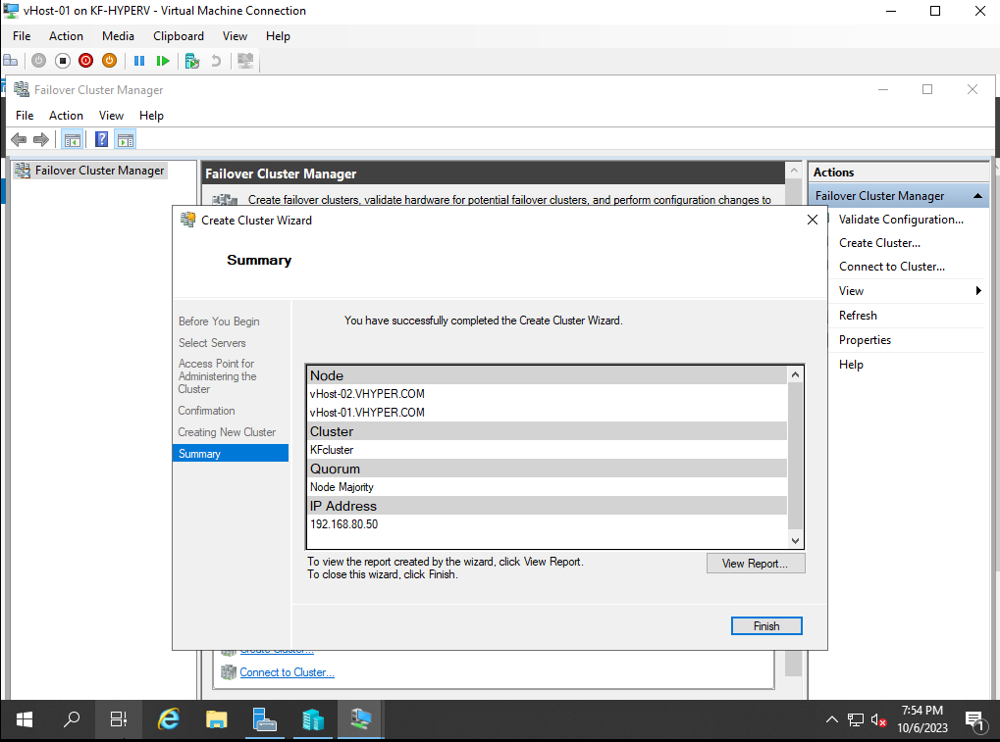
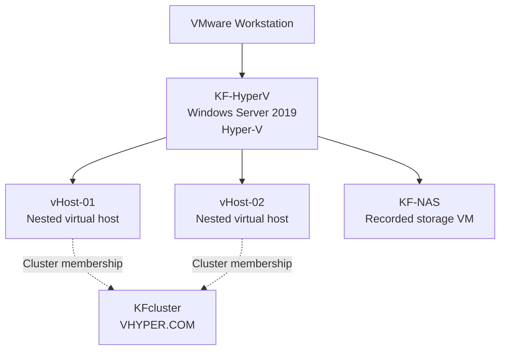
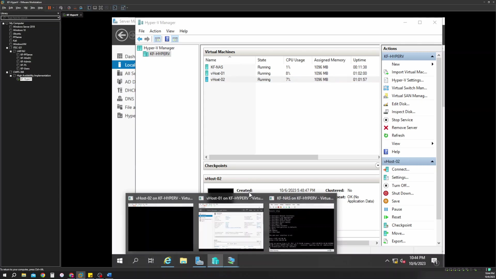
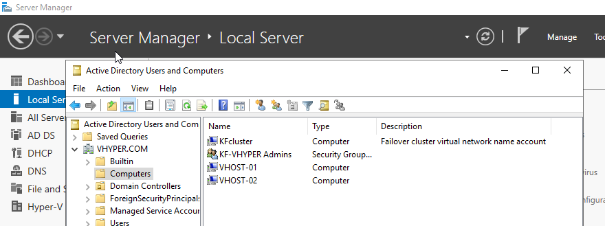
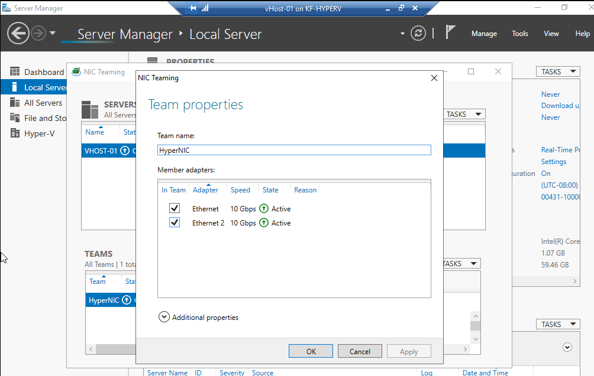
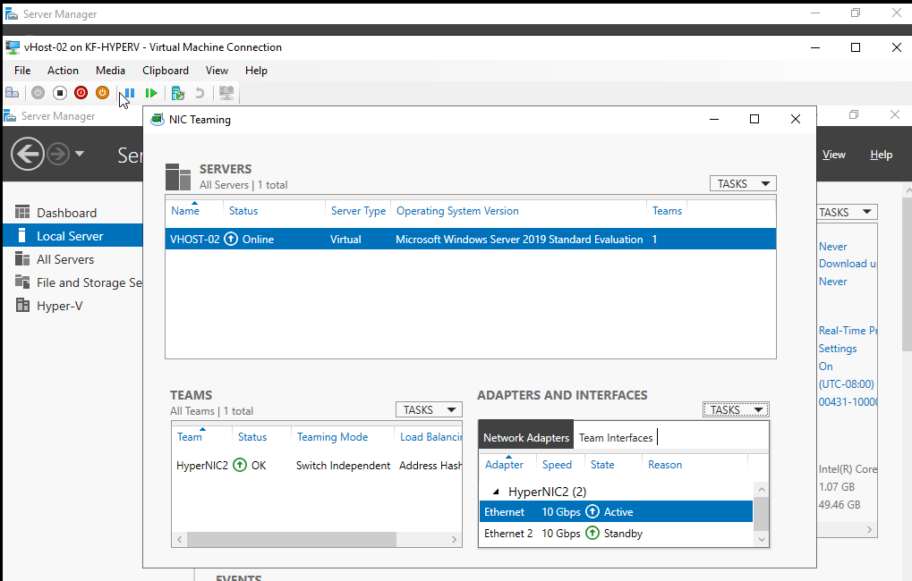
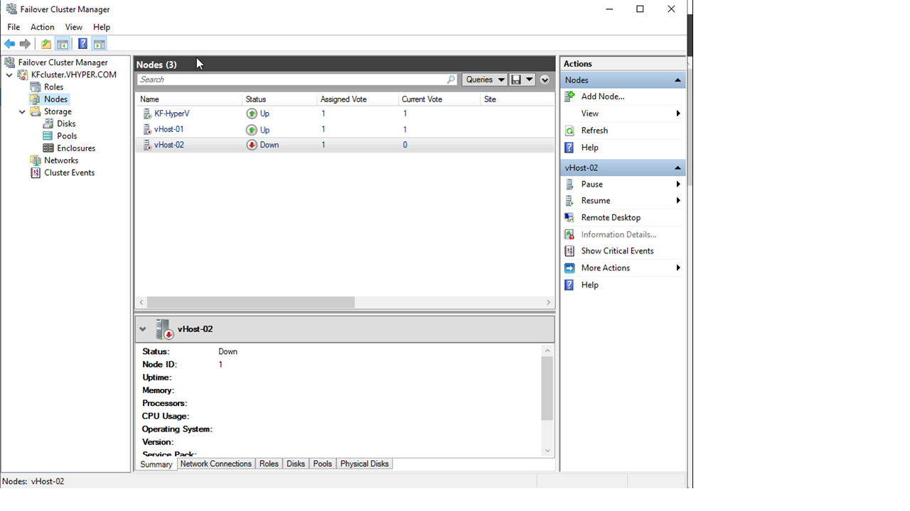
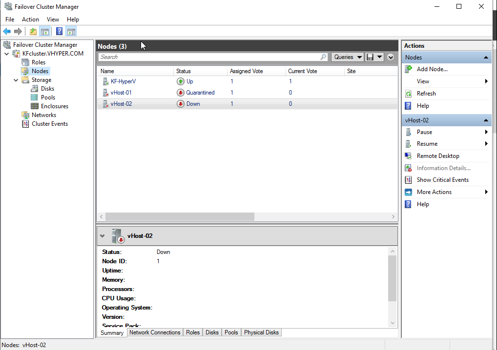
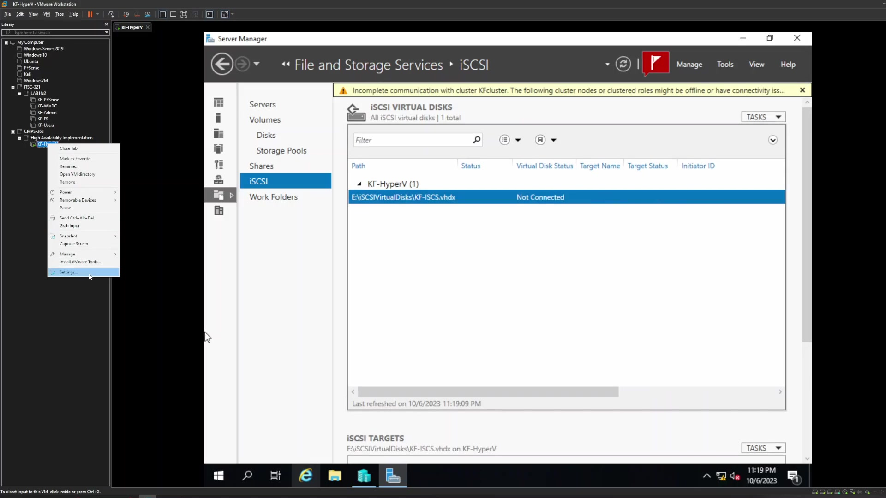

# Hyper-V Cluster Configuration & Troubleshooting

**SAIT · Data Center Management and Virtualization (CMPS-368) · October 2023**  
**Windows Server 2019 · Hyper-V · VMware Workstation · Active Directory · NIC teaming**

Worked on a nested Hyper-V lab in VMware Workstation to explore Windows Server clustering, virtual networking, and shared-storage configuration. Screenshots and a demonstration recording document the setup, including the problems encountered while trying to establish high availability.

## My work

- Set up a Windows Server lab with Hyper-V and nested virtual hosts.
- Created `KFcluster` with `vHost-01` and `vHost-02` in the `VHYPER.COM` lab domain.
- Configured virtual network adapter teams and documented their adapter states.
- Captured cluster membership, node availability, quarantine, and storage-connectivity issues during troubleshooting.

My retained evidence shows configuration progress and troubleshooting. It does not establish a completed, reliable high-availability deployment or successful automatic guest-VM failover.

## Lab architecture

This diagram summarizes the virtualization layers and the two hosts named in the cluster-creation capture. Later troubleshooting screenshots also list `KF-HyperV` as a cluster node. The lab configuration changed during the exercise; the diagram does not represent a verified final three-node design or a working shared-storage path.

## Selected evidence

| Evidence | What my capture shows |
|---|---|
| [Nested virtual machines](assets/nested-vms-running.jpg) | Hyper-V Manager lists `KF-NAS`, `vHost-01`, and `vHost-02` as Running on `KF-HYPERV` |
| [Cluster creation](assets/cluster-created.png) | The creation wizard completes with two named nodes, Node Majority quorum, and cluster IP `192.168.80.50` |
| [Domain registration](assets/domain-computers.png) | Active Directory lists the cluster computer object and both virtual hosts |
| [First host NIC team](assets/nic-team-host01.png) | Two virtual adapters appear as Active in the team-properties capture |
| [Second host NIC team](assets/nic-team-host02.png) | `HyperNIC2` shows OK, with one adapter Active and one Standby |
| [Node-state investigation](assets/cluster-node-down.png) | A later three-node listing shows `vHost-02` Down |
| [Quarantine investigation](assets/cluster-node-quarantined.png) | Another capture shows `vHost-01` Quarantined and `vHost-02` Down |
| [Storage investigation](assets/iscsi-not-connected.jpg) | An iSCSI virtual disk is listed as Not Connected, with a cluster communication warning |

The Running states above describe the nested VMs on their parent hypervisor. They do not show that a clustered workload recovered on another node. The displayed virtual-adapter speeds also do not establish physical-network throughput.

## Skills demonstrated

This exercise gave me practical experience with nested virtualization, Windows Server administration, Active Directory computer objects, Failover Cluster Manager, NIC teaming, and capturing diagnostic evidence across several management interfaces.

The most useful distinction in my notes is between creating a cluster and validating its behavior. I retained both setup milestones and fault states so the record reflects what I achieved and what remained unresolved.

## Detailed evidence

Virtualization and cluster setup

Virtual NIC teaming

These captures establish the displayed configuration and state. They do not include a controlled network failover or throughput test.

Cluster and storage troubleshooting

These are historical fault states, rather than evidence of successful recovery. The retained captures do not establish their exact root causes or a completed resolution.

## Project status

This is a historical configuration and troubleshooting lab. The selected evidence does not demonstrate automatic workload recovery, tested storage redundancy, working VLAN isolation, or completed container-webhost functionality. The original assignment requested some of these outcomes; its requirements are separate from my recorded results.

## Evidence notes

See my [evidence notes](docs/evidence-notes.md) for asset sources and the limits of the historical record. The portfolio contains selected captures and a new summary; the original instructor handouts, rubric, and full recording are not included.
